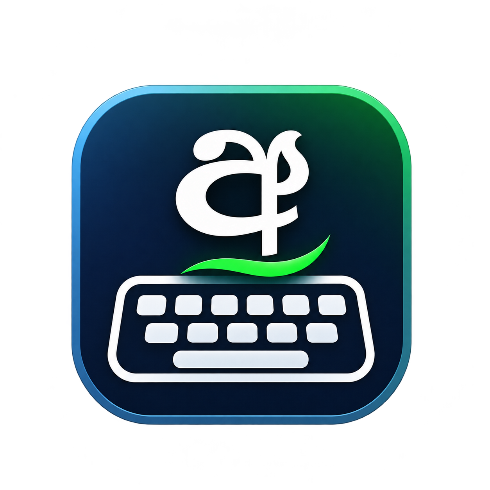

# Sinhala Typing Assistant

A lightweight Windows desktop utility for typing Sinhala using
Wijesekara keyboard layouts or phonetic Singlish input. It converts
keystrokes in real time and can output Sinhala in legacy font encodings
or standard Unicode.

<p align="center">
  
</p>

## Features

-   **Real-time Sinhala typing** using a low-level keyboard hook.
-   **Three input methods:**
    -   Modern Wijesekara
    -   Traditional Wijesekara
    -   Phonetic Singlish
-   **Four output formats:**
    -   DL
    -   FM
    -   ISI
    -   Unicode
-   **Quick enable/disable:** press `F12` to toggle typing assistance.
-   **System tray support:** show the toolbar, toggle typing assistance,
    or exit from the tray menu.
-   **Compact toolbar:** the toolbar automatically collapses and expands
    when the mouse moves over it.
-   **Symbol escape:** type `\` before a character to enter it as a
    mapped symbol. Type `\\` to insert a literal backslash.

## Project structure

``` text
SinhalaTypeBypasser/
├── Assets/
│   ├── data_list.json
│   ├── icon.ico
│   └── SinhalaKeyboard.png
├── App.xaml
├── AssemblyInfo.cs
├── GlobalKeyboardHook.cs
├── icon.ico
├── MainWindow.xaml
├── MainWindow.xaml.cs
├── TranslationEngine.cs
└── README.md
```

## Requirements

-   Windows
-   .NET SDK compatible with the target framework configured in
    `SinhalaTypeBypasser.csproj`

## Build and run

1.  Clone or download this repository.

2.  Open a terminal in the project directory (the directory containing
    `SinhalaTypeBypasser.csproj`).

3.  Restore dependencies and build:

    ``` powershell
    dotnet restore
    dotnet build
    ```

4.  Run the application:

    ``` powershell
    dotnet run
    ```

The master conversion dictionary must be available at
`Assets/data_list.json` in the application's output directory. Make sure
the project copies the `Assets` folder contents to the output directory
when building.

## Using the application

1.  Launch **Sinhala Typing Assistant**.
2.  Choose an input method from the toolbar.
3.  Choose the required output format.
4.  Enable **Typing Assist**.
5.  Type in your target application. Converted text is inserted at the
    current caret position.
6.  Press `F12` whenever you need to enable or disable conversion
    quickly.

### Input methods

  -----------------------------------------------------------------------
  Input method                        Description
  ----------------------------------- -----------------------------------
  Modern Wijesekara                   Uses the modern Wijesekara key
                                      sequence.

  Traditional Wijesekara              Uses the traditional Wijesekara key
                                      sequence.

  Phonetic Singlish                   Converts phonetic Latin-letter
                                      input into Sinhala.
  -----------------------------------------------------------------------

### Output formats

  Format    Description
  --------- -------------------------------
  DL        DL legacy font encoding
  FM        FM legacy font encoding
  ISI       ISI legacy font encoding
  Unicode   Standard Sinhala Unicode text

For legacy output formats, use a compatible Sinhala legacy font in the
application where you are typing. Unicode output should be used with
applications and fonts that support Sinhala Unicode.

## Keyboard behaviour

-   `F12` --- Toggle Typing Assist.
-   `\` followed by a mapped symbol --- Insert the mapped symbol.
-   `\\` --- Insert a literal backslash.
-   Whitespace and navigation/editing keys reset the current conversion
    buffer.
-   Standard `Ctrl`, `Alt`, and Windows-key shortcuts are passed through
    without Sinhala conversion.

## Data and assets

-   `Assets/data_list.json` contains the Sinhala character mappings used
    by the conversion engine.
-   `Assets/SinhalaKeyboard.png` is the keyboard layout reference image
    displayed above.
-   `Assets/icon.ico` and the root-level `icon.ico` are icon assets. The
    application code should use the intended icon path and ensure the
    file is copied to the build output if it is loaded at runtime.

## Notes

-   The application uses a global keyboard hook to detect key presses
    and inject converted text into the active application.
-   Keep the application running while you want typing assistance to be
    available.
-   If conversion does not work, check that **Typing Assist** is enabled
    and that the selected input method and output format match the
    keyboard layout and font you are using.

## License

See [LICENSE.txt](LICENSE.txt) for license information.
